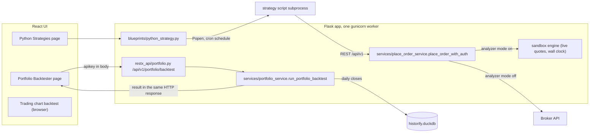
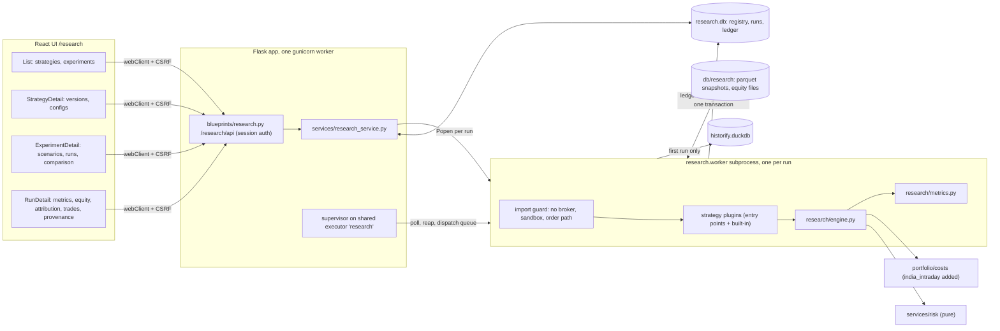
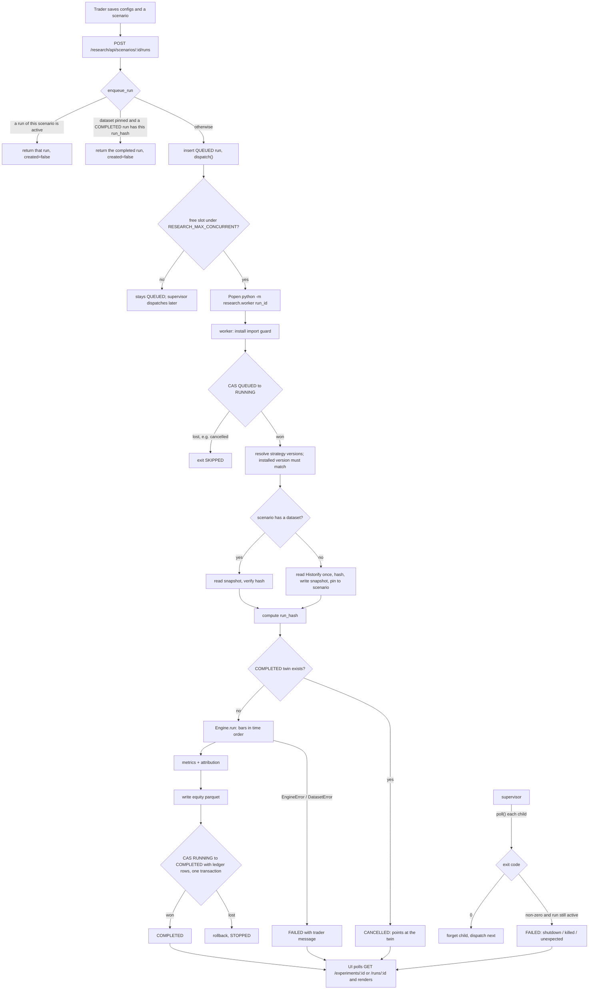

# Research Backtests: Full Feature Flow

A reviewer's walkthrough of the `/research` addition: what OpenAlgo looked like
before it, what was added, and how one backtest travels from a button click to
a reconciled ledger and back. Every claim below is tied to the code at the
commit named in section 2.

## 1. Feature overview

**What it is.** Research is a strategy research layer inside this OpenAlgo fork.
It keeps an immutable registry of strategy versions and configuration
versions, groups strategies into experiments made of scenarios, and runs each
scenario through a deterministic backtest engine that never touches a broker.

**What it does.** A trader picks one or more strategies, a configuration for
each (capital, leverage, entry and exit time, stop, target, universe), a date
window and a cost model, and chooses how the strategies share money:

- **Isolated**: each strategy gets its own capital and positions. Answers
  "which strategy does better on the same resources?"
- **Shared**: all strategies trade one portfolio. Their orders are netted
  before they would reach a broker, costs are charged on the netted order, and
  each strategy still keeps its own P&L. Answers "what happens if I actually
  run these together?"

Every run records exactly which strategy code, configuration, market data,
costs and engine produced it, and cannot be edited afterwards.

**Example.** On an experiment page the trader adds a scenario "S2 shared":
mode Shared, 2024-01-01 to 2024-01-12, India intraday costs with 2 bps
slippage, and two instances of `first_bar_leader` (config v1, Rs 5 lakh each).
They click **Run**. The page shows the run queued, then a progress bar, then
the net P&L. The run page shows the equity curve, a by-strategy attribution
table, every round trip, and a "What produced this result" block with the run
hash, dataset hash, strategy version and config version. Clicking **Run** again
returns the same run instead of computing it twice.

## 2. Opening context

- **Branch:** `feature/research-backtest`
- **Commit walked through:** `42825d133` (branched from `dev` at `782adb740`)
- **Diff against `dev`:** 39 files, about 8,900 lines added, 8 removed.

Important current behaviour:

- Each run executes in its **own subprocess** (`python -m research.worker <run_id>`),
  never inside the app process. The app only queues, spawns, polls and reaps.
- The worker installs an **import guard** before anything else that refuses
  the broker plugins, the sandbox, order placement, the broker history service
  and the auth-token store. This is the PRD section 65 boundary.
- **Inputs are immutable.** Strategy versions, config versions, scenarios,
  datasets and ledger rows refuse ORM updates. Run status changes only through
  compare-and-set writes.
- The **first run** of a scenario reads Historify once and pins a parquet
  snapshot hashed by bar values. **Later runs** read only the snapshot.
- A run's identity is `run_hash`. **At most one COMPLETED run per hash**
  (a partial unique index), and enqueuing a scenario whose result already exists
  returns that result.
- Isolated, single and shared runs are **one engine code path**; the mode only
  decides how strategy books are grouped into portfolios.
- The UI **polls** (every 2 seconds while a run is active). No Socket.IO events
  are added.
- UI endpoints are **session-authenticated** under `/research/api`, not the
  API-key surface under `/api/v1`.

## 3. High-level design: before and after

### 3.1 The starting point (`dev` at `782adb740`)

OpenAlgo already had four pieces this feature touches. None of them could
answer "how do these strategies do on the same history, alone and together,
reproducibly":



What each piece offered, and why it was not enough on its own:

**Portfolio Backtester: synchronous, weights-based, daily.** The backtest runs
inside the HTTP request. That is fine for its job (daily weight targets,
rebalancing) but it has no strategies, no order-level fills, no intraday bars
and no stored runs.

`restx_api/portfolio.py`:

```python
@api.route("/backtest", strict_slashes=False)
class PortfolioBacktest(Resource):
    @limiter.limit(API_RATE_LIMIT)
    def post(self):
        """Backtest a weighted portfolio and return its full analysis."""
        try:
            data = backtest_schema.load(request.json or {})
```

**Python Strategy Host: live scripts, no versions.** Strategies are files in
`strategies/scripts/`, started as subprocesses on a schedule, and they reach
orders over REST. Editing a script overwrites it in place, so there is no
version to tie a result to.

`blueprints/python_strategy.py`:

```python
strategy_env = os.environ.copy()
strategy_env["STRATEGY_ID"] = strategy_id
strategy_env["STRATEGY_NAME"] = config.get("name", strategy_id)
strategy_env["OPENALGO_STRATEGY_EXCHANGE"] = normalize_exchange(config.get("exchange"))
strategy_env.setdefault("OPENALGO_HOST", "http://127.0.0.1:5000")
```

**Order path: one global switch decides live or sandbox.** Any code that
reaches `place_order_with_auth` goes to the real broker unless analyzer mode is
on. That switch is the only thing between a script and real money.

`services/place_order_service.py`:

```python
if get_analyze_mode() and not force_live:
    from services.sandbox_service import sandbox_place_order
```

**Sandbox: live simulation, not replay.** The sandbox fills orders against live
quotes and stamps them with the wall clock, so it cannot replay history.

`sandbox/execution_engine.py`:

```python
update_timestamp=datetime.now(pytz.timezone("Asia/Kolkata")),
```

**Reusable as-is.** `portfolio/costs.py` (cost schedules),
`portfolio/analytics.summary` (openstatz metrics), `services/risk/` (pure
stop and target rules) and `database/historify_db.get_ohlcv` (1m and D bars,
other intervals aggregated) were all usable by a new engine without change,
apart from one import fix described in section 5.

### 3.2 After the addition



### 3.3 What changed, in one table

| Concern | Before | After |
| --- | --- | --- |
| Strategy identity | A script file, edited in place | `research_strategy_versions`: dist name and version, source hash, artifact hash; never edited |
| Configuration | None for backtests | `research_config_versions`: hashed, versioned, never edited |
| Backtest execution | Inside the HTTP request (Portfolio Backtester) | A subprocess per run, queued and capped |
| Bars | Daily closes (Portfolio Backtester) | Any Historify interval, frozen into a hashed snapshot per scenario |
| Fills | Weight drift and rebalance | Order level, next bar open, costs and slippage per order |
| Multi-strategy | None | Isolated and shared modes on one engine path, with netting and attribution |
| Reproducibility | Results not stored | `run_hash`, dataset hash, engine hash, immutable ledger |
| Broker safety | The analyzer switch | An import guard in the backtest process; no setting turns it off |
| Existing files touched | | `app.py` (4 lines), `utils/db_sessions.py`, `.sample.env`, `test/conftest.py`, `upgrade/migrate_all.py`, the three page registrations, `portfolio/__init__.py` (lazy imports), `portfolio/costs.py` (new preset), two gthread gate review lists |

## 4. Full flow diagram



## 5. Request and response shapes

**Save a configuration** (`POST /research/api/strategies/<id>/configs`):

```json
{
  "config": {
    "capital": 500000, "allocation": 1.0, "leverage": 1.0, "product": "MIS",
    "entry_time": "09:16", "exit_time": "15:10", "stop_pct": null, "target_pct": null,
    "universe": ["RELIANCE", "INFY"], "exchange": "NSE", "execution_mode": "backtest"
  },
  "parent_id": 12,
  "note": "leverage test"
}
```

Response: `{"status": "success", "item": {<config version>}, "created": true}`,
HTTP 201 for a new version or 200 when an identical one already exists.

**Create a scenario** (`POST /research/api/experiments/<id>/scenarios`):

```json
{
  "name": "S2 shared", "mode": "SHARED", "start": "2024-01-01", "end": "2024-01-12",
  "cost_model": {"preset": "india_intraday_nse", "slippage_bps": 2},
  "risk_policy": {"max_gross_leverage": 1.0},
  "shared_capital": null,
  "instances": [{"strategy_version_id": 1, "config_version_id": 1},
                {"strategy_version_id": 1, "config_version_id": 1}]
}
```

The dataset's symbols, exchange and interval are **derived**, not sent: symbols
are the union of the configs' universes, and interval and exchange must agree
across instances.

**Run** (`POST /research/api/scenarios/<id>/runs`) returns
`{"status": "success", "item": {<run>}, "created": true|false}`. A run dict:

The metric values below are from the end-to-end check of the shared scenario
described in section 1.

```json
{
  "id": 2, "scenario_id": 2, "status": "COMPLETED", "progress": 1.0, "message": null,
  "run_hash": "81a3b84bf1...", "engine_version": "1", "engine_hash": "...",
  "metrics": {"capital": 1000000, "net_pnl": 16811.5, "return_pct": 1.68, "trades": 20,
              "costs": 8020.03, "max_drawdown_pct": -3.93, "sharpe": 3.64, "cagr_pct": null,
              "conflicts": 0, "...": "..."},
  "attribution": [{"instance": 0, "label": "first_bar_leader (config v1)", "net_pnl": "...",
                   "reduced_by_limit": 0, "...": "same metric keys as above"}]
}
```

Every error response is `{"status": "error", "message": "<sentence for the trader>"}`.

## 6. Flow in execution order

### Shared setup: the registry and configuration versions

#### 6.1 The page loads the strategy list, which syncs the registry

`blueprints/research.py` -> `services/research_service.list_strategies` ->
`sync_registry`

`GET /research/api/strategies` first records any strategy version this process
has not seen. `research/strategy.discover()` returns the built-in reference
strategy plus every installed `openalgo.strategies` entry point;
`version_identity()` builds the strategy once and hashes its identity. A new
`version_hash` is inserted; nothing existing is updated.

`research/strategy.py`:

```python
identity = {
    "key": spec.key,
    "source": spec.source,
    "dist_name": spec.dist_name,
    "dist_version": spec.dist_version,
    "code_hash": _code_hash(spec),
    "artifact_hash": getattr(strategy, "artifact_hash", None),
    "interval": strategy.interval,
}
identity["version_hash"] = sha256_hex(canonical_json(identity))
```

A strategy that fails to load is reported in `problems` and does not hide the
others.

#### 6.2 Saving a configuration: validation at the boundary, once

`frontend/src/pages/research/StrategyDetail.tsx` -> `saveConfig()` ->
`services/research_service.save_config` -> `research/strategy.Config`

The form becomes a `ResearchConfig` (`configFromForm`) and is posted.
`Config.from_dict` is the single validation point: positive capital,
allocation at most 100%, MIS needs an exit time after the entry time, valid
symbols, backtest only. Each refusal is a sentence for the trader. The config
is a frozen dataclass hashed by value, so saving an identical config returns
the existing version instead of creating one.

```python
config_hash = config.config_hash
for _attempt in range(2):
    existing = (
        session.query(rdb.ResearchConfigVersion)
        .filter_by(strategy_id=strategy_id, config_hash=config_hash)
        .one_or_none()
    )
    if existing is not None:
        return rdb.config_to_dict(existing), False
```

Immutability is enforced in `database/research_db.py`, not by convention:

```python
@event.listens_for(ResearchStrategyVersion, "before_update")
@event.listens_for(ResearchConfigVersion, "before_update")
@event.listens_for(ResearchScenario, "before_update")
...
def _refuse_update(mapper, connection, target):
    raise ImmutableRecordError(...)
```

#### 6.3 Creating a scenario

`services/research_service.create_scenario`

Checks that every config belongs to the strategy it is paired with, that all
instances share one bar interval (they share one clock) and one exchange, that
the cost preset exists in `portfolio.costs.PRESETS`, and that slippage and the
exposure limit are in range. The dataset spec is derived from the instances,
then the scenario and its instances are stored. A scenario is never edited
afterwards; trying different settings means adding another scenario.

### The run flow

#### 6.4 Entrypoint: the Run button

`frontend/src/pages/research/ExperimentDetail.tsx` -> `api/research.ts runScenario`

```ts
mutationFn: () => runScenario(scenario.id),
onSuccess: ({ created, item }) => {
  if (!created && item.status === 'COMPLETED') {
```

```ts
webClient.post<Envelope & { item: ResearchRun; created: boolean }>(
  `/research/api/scenarios/${scenarioId}/runs`
),
```

`webClient` carries the session cookie and the CSRF token. There is no request
body.

#### 6.5 Request handling

`blueprints/research.py`

The handler only translates: session check, rate limit, call the service,
shape the JSON. `ResearchError` becomes a 400 with the service's message;
anything else is logged and becomes a 500 with a generic sentence.

```python
def run_scenario(scenario_id: int):
    try:
        item, created = svc.enqueue_run(scenario_id)
    except svc.ResearchError as exc:
        return _error(str(exc))
```

#### 6.6 Enqueue: deduplicate, then queue

`services/research_service.enqueue_run`

Two refusals to duplicate work. A scenario already running returns that run;
two first runs racing would both pin data. And when the scenario's data is
already pinned, the `run_hash` is computable before running, so an existing
completed result is returned instead of being recomputed (PRD section 17).

```python
if scenario.dataset_id:
    dataset = session.get(rdb.ResearchDataset, scenario.dataset_id)
    run_hash, _ = scenario_identity(session, scenario, dataset.dataset_hash)
    done = (
        session.query(rdb.ResearchRun)
        .filter_by(run_hash=run_hash, status=rdb.COMPLETED)
        .first()
    )
    if done is not None:
        return rdb.run_to_dict(done), False
run = rdb.ResearchRun(scenario_id=scenario_id, status=rdb.QUEUED, message="Waiting to start")
```

#### 6.7 Dispatch: spawn a worker process

`services/research_service._dispatch_locked`, `_spawn`, `_ensure_supervisor_locked`

Under the module lock, queued runs are started oldest first up to
`RESEARCH_MAX_CONCURRENT`. Output goes to a log file, never a pipe. The child
gets address-space and descriptor limits, and an environment that keeps
OpenBLAS and Arrow from reserving memory the limit would count (without that,
a parquet write reserved 1.1 GB it never used and the next import failed).

```python
process = subprocess.Popen(
    [sys.executable, "-m", "research.worker", str(run_id)],
    cwd=str(PROJECT_ROOT),
    stdin=subprocess.DEVNULL,
    stdout=log,
    stderr=subprocess.STDOUT,
    close_fds=True,
    env=_child_env(),
    preexec_fn=_limit_child if os.name == "posix" else None,
)
```

The HTTP response returns here with the QUEUED run. Everything below happens
after the request has finished.

#### 6.8 Worker start: the broker boundary, then the claim

`research/worker.py main`, `install_guard`, `execute`

The first thing the process does is put `_RefuseOrderPath` at the front of
`sys.meta_path`. Importing a forbidden module raises `ImportError` from then
on, and the guard also checks that none was already loaded. Strategy plugins
are imported after this, so the guard covers them.

```python
FORBIDDEN_PACKAGES = (
    "broker", "sandbox", "blueprints", "restx_api", "websocket_proxy",
    "services.history_service", "database.auth_db", "utils.httpx_client",
)
FORBIDDEN_PREFIXES = ("services.place_", "services.sandbox")
```

Then a compare-and-set claim, so a run cancelled while queued is never
started:

```python
claimed = (
    session.query(rdb.ResearchRun)
    .filter_by(id=run_id, status=rdb.QUEUED)
    .update({rdb.ResearchRun.status: rdb.RUNNING, ...}, synchronize_session=False)
)
session.commit()
if not claimed:
    return "SKIPPED"
```

#### 6.9 Resolve the strategies

`research/worker.py execute`

For each instance the worker finds the installed strategy by key and refuses to
run if the installed version's hash differs from the version the scenario
recorded. A result is never attributed to code that did not produce it. Each
instance gets a fresh strategy object, so no state leaks between instances or
runs.

#### 6.10 Market data: pin once, replay forever

`research/worker.py execute`, `research/dataset.py`

```python
else:
    spec = DatasetSpec(**scenario.dataset_spec)
    frames = load_from_historify(spec)
    digest = dataset_hash(frames)
    ...
    session.query(rdb.ResearchScenario).filter_by(id=scenario.id, dataset_id=None).update(
        {rdb.ResearchScenario.dataset_id: dataset.id}, synchronize_session=False
    )
```

`dataset_hash` hashes the bar **values** in sorted symbol order, so parquet
byte differences never read as a change. Historify answers both "no rows" and
"could not read" with an empty frame, so the missing-symbol message names the
fix an operator can check first (download the bars in Historify). On later
runs the snapshot is re-read and its hash verified.

#### 6.11 Run identity and the completed-twin check

`research/worker.scenario_identity`

`run_hash` covers, in order: each instance's `version_hash` and `config_hash`,
the dataset hash, mode, cost model, execution model, risk policy, shared
capital, `ENGINE_VERSION` and `CONFLICT_POLICY`. If a COMPLETED run already
holds it, this run ends CANCELLED with a message pointing at that run.

#### 6.12 The engine: books, portfolios, one clock

`research/engine.py Engine.__init__`, `run`

Isolated builds one portfolio per book; shared builds one portfolio holding
every book. All symbols are aligned on one sorted clock with NaN for missing
bars and read-only arrays. Each bar is two passes: orders decided at the
previous close fill at this open, then at this close positions are marked,
forced exits are decided, and strategies decide.

```python
for i in range(bars):
    self._fill_pending(i, "open")
    marks = {s: self._mark(s, i) for s in self.symbols}
    ...
            elif config.product == "MIS" and (
                last_of_day or self.minute[i + 1] >= config.exit_minute
            ):
                forced = dict.fromkeys(
                    self._held(book), "exit_time" if not last_of_day else "eod"
                )
            else:
                forced = self._risk_exits(book, i)
            targets = self._decide(book, b, i, marks, forced)
            self._queue(book, b, i, targets, forced)
        self._apply_exposure_limit(i)
        if last_of_day:
            # Nothing may wait for a bar that belongs to another day.
            self._fill_pending(i, "close")
```

- **Stops and targets** come from `services.risk.evaluate_position`; the engine
  builds a `PositionRisk` and reads the decision.
- **Strategies** see a `Context`: IST day and minute, `bars(symbol)` sliced to
  the current bar, their own positions and equity, a read-only config. They
  return signed weights; the engine converts them to quantities on
  `capital x allocation x leverage` and refuses a total above 100% or a symbol
  outside the universe.
- **Shared exposure limit**: when the netted portfolio would exceed
  `shared capital x max_gross_leverage`, every book's new target is scaled by
  one factor and each reduction is counted.

#### 6.13 Fills, netting and cost allocation

`research/engine.py _fill`

This is the shared-mode conflict policy (`net-v1`). Per portfolio and symbol,
the books' deltas are netted. Only a non-zero net produces a market order, and
fees (from `CostSchedule.breakdown`) and slippage are charged on it. They are
allocated to the books trading in the net's direction, pro rata, the last book
taking the remainder so the pieces sum exactly. Every book is filled with its
full delta at the same price, which keeps each strategy's P&L its own.

```python
net = sum(delta for _, (delta, _) in ordered)
...
if net:
    notional = abs(net) * price
    buy, sell = (notional, 0.0) if net > 0 else (0.0, notional)
    breakdown = self.costs.breakdown(buy, sell, orders=1)
    fees = breakdown["total"] - breakdown["slippage"]
    slippage = notional * self.slip
...
carriers = [(b, d) for b, (d, _) in ordered if net and (d > 0) == (net > 0)]
```

`_apply` writes a fill per book and moves cash; `_trade_leg` tracks round trips
from flat to flat, splitting a flip into a close and an open. Isolated mode
runs the same function with one book per portfolio, so there is never anything
to net.

#### 6.14 Metrics and attribution

`research/worker.summarize_result`, `research/metrics.summarize`

Trade statistics come from round trips; max drawdown from the bar-level equity
curve; CAGR, Sharpe and Sortino from `portfolio.analytics.summary`
(openstatz). CAGR stays `null` below a one-year window. The portfolio row uses
the summed equity; each book gets its own row with `reduced_by_limit`.

#### 6.15 Persist: ledger and completion in one transaction

`research/worker.py execute`

Ledger rows are keyed `(run_id, seq)`, where `seq` is the deterministic order
the engine emitted the event, so a retry collides instead of duplicating. The
COMPLETED write is a compare-and-set on RUNNING: if the run was cancelled in the
meantime, nothing is written.

```python
for row in result.orders:
    session.add(rdb.LedgerOrder(run_id=run_id, **row))
...
completed = runs.filter_by(status=rdb.RUNNING).update(
    {rdb.ResearchRun.status: rdb.COMPLETED, ..., rdb.ResearchRun.run_hash: run_hash, ...},
    synchronize_session=False,
)
if not completed:
    session.rollback()
    return "STOPPED"
session.commit()
```

Failure paths: `EngineError` and `DatasetError` carry trader messages and
become FAILED with that text; `MemoryError` becomes a specific memory message;
anything else is logged with its traceback and becomes a generic FAILED.

#### 6.16 Supervisor: reaping and settling dead workers

`services/research_service._supervise`, `_reap_locked`, `_exit_message`

One loop on the shared `research` executor polls every child with `poll()`,
which reaps without blocking the eventlet hub, kills a cancelled child after a
5 second grace period, and dispatches the next queued run. A non-zero exit
while the run is still active is settled as FAILED, with a cause only where it
is known: a server shutdown says so, and SIGKILL (the out-of-memory killer's
signal) mentions memory. The loop exits when nothing is running.

#### 6.17 UI: polling and rendering

`frontend/src/pages/research/ExperimentDetail.tsx`, `RunDetail.tsx`

```ts
refetchInterval: (query) => (anyActive(query.state.data) ? 2000 : false),
```

The experiment page polls only while a run is QUEUED or RUNNING, then shows
the comparison table (latest completed run per scenario). The run page loads
the run, then the trades (paged, 500 at a time) and the equity curve. The
server thins the curve to at most 1,500 points, and the page plots the last
value of each IST day through `PortfolioLineChart`. The provenance block shows
the run hash, engine version and hash, dataset hash and bar count, and every
instance's strategy version, model hash and config version.

## 7. Reviewer notes

- **The guard is the safety claim.** `test_the_backtest_path_imports_nothing_on_the_order_path`
  imports every worker-path module in a fresh process and asserts no forbidden
  module loaded. It cannot stop plugin code that opens a socket itself; that
  needs OS-level isolation (Phase 8).
- **`portfolio/__init__.py` became lazy** (PEP 562). Before, importing
  `portfolio.costs` imported `portfolio.data`, then the broker history
  service, then `database.auth_db`, which the guard would have refused.
  Existing `from portfolio import load_prices` imports are unchanged.
- **Determinism** is pinned by `test_identical_inputs_give_identical_ledgers`.
  Deduplication means a rerun returns the stored result; it does not recompute
  and compare.
- **Run status is never set blindly.** Claim (QUEUED to RUNNING), progress,
  completion and the supervisor's settle are each guarded on the expected
  status. `fail_orphaned_runs` at startup fails anything a dead process left
  active.
- **Known simplifications:** stops are detected on the close and filled at the
  next open; the shared exposure limit scales only targets that changed that
  bar; a pending order on a symbol with no price waits indefinitely. Each is
  marked `# ponytail:` in `research/engine.py`.
- **Costs differ from algo-trading's research numbers.** Research charges
  `india_intraday` plus flat slippage in basis points, not algo-trading's TO-1
  spread model.
- **Under gthread**, the supervisor flags are decided under the module lock;
  both gthread gates pass, with the supervisor loop and that function recorded
  in the reviewed lists.
- **Not deployable yet**: production runs the upstream image (see the design
  README).

## 8. Shortest mental model

1. Strategies are installed packages; each distinct code or model is an
   immutable version. Configurations are immutable, hashed versions.
2. A scenario binds strategy versions, config versions, a window, costs and a
   mode (isolated or shared), and is never edited.
3. **Run** queues a row; the app spawns `python -m research.worker <id>` and
   returns at once.
4. The worker locks out the order path, claims the run, checks the installed
   strategy versions match, and loads bars from a frozen snapshot (pinned from
   Historify on the first run).
5. It computes `run_hash`; an identical completed run ends this one.
6. The engine replays one clock: fill at the open, then mark, exits, decisions.
   Shared mode nets orders across books and allocates costs to the books that
   carried the net order.
7. Metrics, ledger and COMPLETED are written in one compare-and-set
   transaction.
8. The supervisor reaps the process; the UI polls until the run is final and
   shows results with full provenance.
