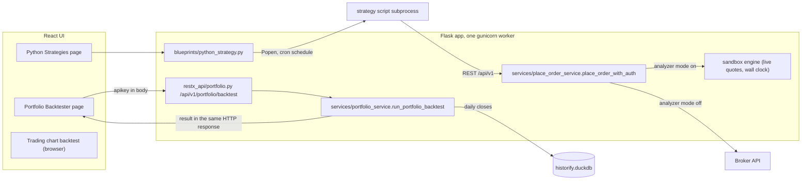
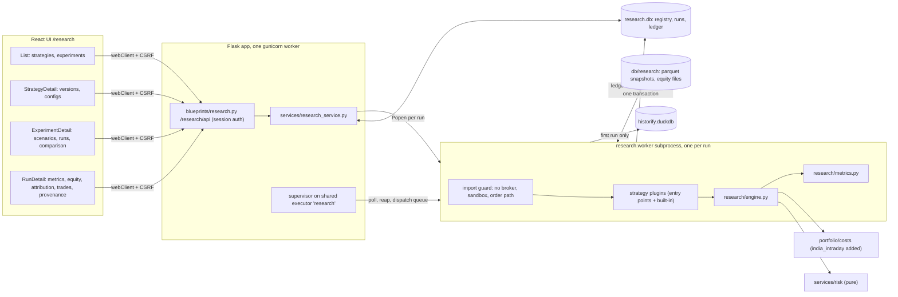
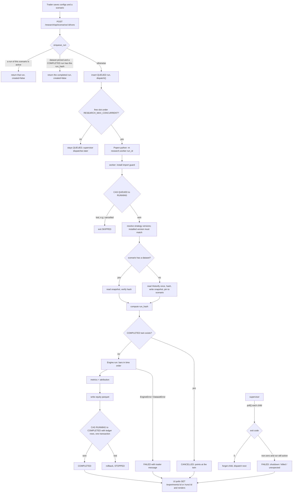
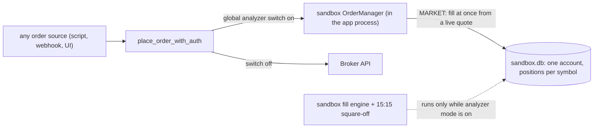
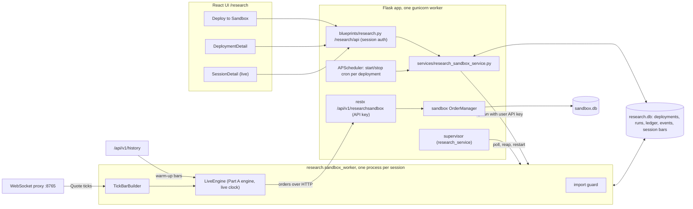
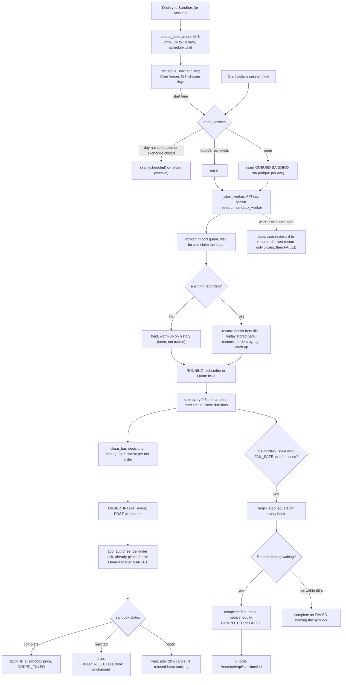
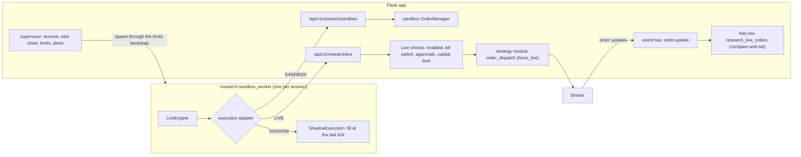
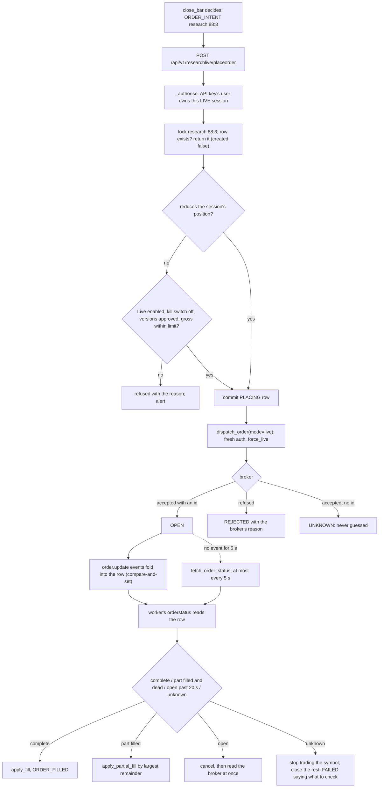

# Research Backtests, Sandbox, Shadow and Live: Full Feature Flow

A reviewer's walkthrough of the `/research` addition, in three parts, each in
the same shape: what OpenAlgo looked like before, what was added, and how one
unit of work travels from a button click to a reconciled ledger and back.

- **Part A, backtests (PRD Phases 1 to 4):** one backtest run.
- **Part B, Sandbox sessions (PRD Phase 8):** one trading day of a scenario
  deployed to the Sandbox, built on Part A's engine and ledger.
- **Part C, Shadow and Live, and the session's runtime (PRD Phases 9 and 7):**
  the same session sending its orders nowhere or to the broker, and what keeps
  a session managed when its worker fails.

Parts A and B are tied to the code at the commit named in section 2, and every
snippet is quoted from it; Part C describes the branch as of 2026-10-11.

# Part A: Backtests

## 1. Feature overview

**What it is.** Research is a strategy research layer inside this OpenAlgo fork.
It keeps an immutable registry of strategy versions and configuration
versions, groups strategies into experiments made of scenarios, and runs each
scenario through a deterministic backtest engine that never touches a broker.

**What it does.** A trader picks one or more strategies, a configuration for
each (capital, leverage, entry and exit time, stop, target, universe), a date
window and a cost model, and chooses how the strategies share money:

- **Isolated**: each strategy gets its own capital and positions. Answers
  "which strategy does better on the same resources?"
- **Shared**: all strategies trade one portfolio. Their orders are netted
  before they would reach a broker, costs are charged on the netted order, and
  each strategy still keeps its own P&L. Answers "what happens if I actually
  run these together?"

Every run records exactly which strategy code, configuration, market data,
costs and engine produced it, and cannot be edited afterwards.

**Example.** On an experiment page the trader adds a scenario "S2 shared":
mode Shared, 2024-01-01 to 2024-01-12, India intraday costs with 2 bps
slippage, and two instances of `first_bar_leader` (config v1, Rs 5 lakh each).
They click **Run**. The page shows the run queued, then a progress bar, then
the net P&L. The run page shows the equity curve, a by-strategy attribution
table, every round trip, and a "What produced this result" block with the run
hash, dataset hash, strategy version and config version. Clicking **Run** again
returns the same run instead of computing it twice.

## 2. Opening context

- **Branch:** `feature/research-backtest` (branched from `dev` at `782adb740`)
- **Commit walked through:** the commit that adds Part B to this document, on
  top of `ed6d3d7d3` and the three fixes after it (the strategy-code boundary,
  failing safe on a strategy error, a supervisor guard). Part A was first
  written at `42825d133`; its snippets were refreshed where later work changed
  the code (6.7, 6.8 and 6.12).

Important current behaviour:

- Each run executes in its **own subprocess** (`python -m research.worker <run_id>`),
  never inside the app process. The app only queues, spawns, polls and reaps.
- The worker installs an **import guard** before anything else that refuses
  the broker plugins, the sandbox, order placement, the broker history service
  and the auth-token store. This is the PRD section 65 boundary.
- **Inputs are immutable.** Strategy versions, config versions, scenarios,
  datasets and ledger rows refuse ORM updates. Run status changes only through
  compare-and-set writes.
- The **first run** of a scenario reads Historify once and pins a parquet
  snapshot hashed by bar values. **Later runs** read only the snapshot.
- A run's identity is `run_hash`. **At most one COMPLETED run per hash**
  (a partial unique index), and enqueuing a scenario whose result already exists
  returns that result.
- Isolated, single and shared runs are **one engine code path**; the mode only
  decides how strategy books are grouped into portfolios.
- The UI **polls** (every 2 seconds while a run is active). No Socket.IO events
  are added.
- UI endpoints are **session-authenticated** under `/research/api`, not the
  API-key surface under `/api/v1`.

## 3. High-level design: before and after

### 3.1 The starting point (`dev` at `782adb740`)

OpenAlgo already had four pieces this feature touches. None of them could
answer "how do these strategies do on the same history, alone and together,
reproducibly":



What each piece offered, and why it was not enough on its own:

**Portfolio Backtester: synchronous, weights-based, daily.** The backtest runs
inside the HTTP request. That is fine for its job (daily weight targets,
rebalancing) but it has no strategies, no order-level fills, no intraday bars
and no stored runs.

`restx_api/portfolio.py`:

```python
@api.route("/backtest", strict_slashes=False)
class PortfolioBacktest(Resource):
    @limiter.limit(API_RATE_LIMIT)
    def post(self):
        """Backtest a weighted portfolio and return its full analysis."""
        try:
            data = backtest_schema.load(request.json or {})
```

**Python Strategy Host: live scripts, no versions.** Strategies are files in
`strategies/scripts/`, started as subprocesses on a schedule, and they reach
orders over REST. Editing a script overwrites it in place, so there is no
version to tie a result to.

`blueprints/python_strategy.py`:

```python
strategy_env = os.environ.copy()
strategy_env["STRATEGY_ID"] = strategy_id
strategy_env["STRATEGY_NAME"] = config.get("name", strategy_id)
strategy_env["OPENALGO_STRATEGY_EXCHANGE"] = normalize_exchange(config.get("exchange"))
strategy_env.setdefault("OPENALGO_HOST", "http://127.0.0.1:5000")
```

**Order path: one global switch decides live or sandbox.** Any code that
reaches `place_order_with_auth` goes to the real broker unless analyzer mode is
on. That switch is the only thing between a script and real money.

`services/place_order_service.py`:

```python
if get_analyze_mode() and not force_live:
    from services.sandbox_service import sandbox_place_order
```

**Sandbox: live simulation, not replay.** The sandbox fills orders against live
quotes and stamps them with the wall clock, so it cannot replay history.

`sandbox/execution_engine.py`:

```python
update_timestamp=datetime.now(pytz.timezone("Asia/Kolkata")),
```

**Reusable as-is.** `portfolio/costs.py` (cost schedules),
`portfolio/analytics.summary` (openstatz metrics), `services/risk/` (pure
stop and target rules) and `database/historify_db.get_ohlcv` (1m and D bars,
other intervals aggregated) were all usable by a new engine without change,
apart from one import fix described in section 5.

### 3.2 After the addition



### 3.3 What changed, in one table

| Concern | Before | After |
| --- | --- | --- |
| Strategy identity | A script file, edited in place | `research_strategy_versions`: dist name and version, source hash, artifact hash; never edited |
| Configuration | None for backtests | `research_config_versions`: hashed, versioned, never edited |
| Backtest execution | Inside the HTTP request (Portfolio Backtester) | A subprocess per run, queued and capped |
| Bars | Daily closes (Portfolio Backtester) | Any Historify interval, frozen into a hashed snapshot per scenario |
| Fills | Weight drift and rebalance | Order level, next bar open, costs and slippage per order |
| Multi-strategy | None | Isolated and shared modes on one engine path, with netting and attribution |
| Reproducibility | Results not stored | `run_hash`, dataset hash, engine hash, immutable ledger |
| Broker safety | The analyzer switch | An import guard in the backtest process; no setting turns it off |
| Existing files touched | | `app.py` (4 lines), `utils/db_sessions.py`, `.sample.env`, `test/conftest.py`, `upgrade/migrate_all.py`, the three page registrations, `portfolio/__init__.py` (lazy imports), `portfolio/costs.py` (new preset), two gthread gate review lists |

## 4. Full flow diagram



## 5. Request and response shapes

**Save a configuration** (`POST /research/api/strategies/<id>/configs`):

```json
{
  "config": {
    "capital": 500000, "allocation": 1.0, "leverage": 1.0, "product": "MIS",
    "entry_time": "09:16", "exit_time": "15:10", "stop_pct": null, "target_pct": null,
    "universe": ["RELIANCE", "INFY"], "exchange": "NSE", "execution_mode": "backtest"
  },
  "parent_id": 12,
  "note": "leverage test"
}
```

Response: `{"status": "success", "item": {<config version>}, "created": true}`,
HTTP 201 for a new version or 200 when an identical one already exists.

**Create a scenario** (`POST /research/api/experiments/<id>/scenarios`):

```json
{
  "name": "S2 shared", "mode": "SHARED", "start": "2024-01-01", "end": "2024-01-12",
  "cost_model": {"preset": "india_intraday_nse", "slippage_bps": 2},
  "risk_policy": {"max_gross_leverage": 1.0},
  "shared_capital": null,
  "instances": [{"strategy_version_id": 1, "config_version_id": 1},
                {"strategy_version_id": 1, "config_version_id": 1}]
}
```

The dataset's symbols, exchange and interval are **derived**, not sent: symbols
are the union of the configs' universes, and interval and exchange must agree
across instances.

**Run** (`POST /research/api/scenarios/<id>/runs`) returns
`{"status": "success", "item": {<run>}, "created": true|false}`. A run dict:

The metric values below are from the end-to-end check of the shared scenario
described in section 1.

```json
{
  "id": 2, "scenario_id": 2, "status": "COMPLETED", "progress": 1.0, "message": null,
  "run_hash": "81a3b84bf1...", "engine_version": "1", "engine_hash": "...",
  "metrics": {"capital": 1000000, "net_pnl": 16811.5, "return_pct": 1.68, "trades": 20,
              "costs": 8020.03, "max_drawdown_pct": -3.93, "sharpe": 3.64, "cagr_pct": null,
              "conflicts": 0, "...": "..."},
  "attribution": [{"instance": 0, "label": "first_bar_leader (config v1)", "net_pnl": "...",
                   "reduced_by_limit": 0, "...": "same metric keys as above"}]
}
```

Every error response is `{"status": "error", "message": "<sentence for the trader>"}`.

## 6. Flow in execution order

### Shared setup: the registry and configuration versions

#### 6.1 The page loads the strategy list, which syncs the registry

`blueprints/research.py` -> `services/research_service.list_strategies` ->
`sync_registry`

`GET /research/api/strategies` first records any strategy version this process
has not seen. `research/strategy.discover()` returns the built-in reference
strategy plus every installed `openalgo.strategies` entry point;
`version_identity()` builds the strategy once and hashes its identity. A new
`version_hash` is inserted; nothing existing is updated.

`research/strategy.py`:

```python
identity = {
    "key": spec.key,
    "source": spec.source,
    "dist_name": spec.dist_name,
    "dist_version": spec.dist_version,
    "code_hash": _code_hash(spec),
    "artifact_hash": getattr(strategy, "artifact_hash", None),
    "interval": strategy.interval,
}
identity["version_hash"] = sha256_hex(canonical_json(identity))
```

A strategy that fails to load is reported in `problems` and does not hide the
others.

#### 6.2 Saving a configuration: validation at the boundary, once

`frontend/src/pages/research/StrategyDetail.tsx` -> `saveConfig()` ->
`services/research_service.save_config` -> `research/strategy.Config`

The form becomes a `ResearchConfig` (`configFromForm`) and is posted.
`Config.from_dict` is the single validation point: positive capital,
allocation at most 100%, MIS needs an exit time after the entry time, valid
symbols, backtest only. Each refusal is a sentence for the trader. The config
is a frozen dataclass hashed by value, so saving an identical config returns
the existing version instead of creating one.

```python
config_hash = config.config_hash
for _attempt in range(2):
    existing = (
        session.query(rdb.ResearchConfigVersion)
        .filter_by(strategy_id=strategy_id, config_hash=config_hash)
        .one_or_none()
    )
    if existing is not None:
        return rdb.config_to_dict(existing), False
```

Immutability is enforced in `database/research_db.py`, not by convention:

```python
@event.listens_for(ResearchStrategyVersion, "before_update")
@event.listens_for(ResearchConfigVersion, "before_update")
@event.listens_for(ResearchScenario, "before_update")
...
def _refuse_update(mapper, connection, target):
    raise ImmutableRecordError(...)
```

#### 6.3 Creating a scenario

`services/research_service.create_scenario`

Checks that every config belongs to the strategy it is paired with, that all
instances share one bar interval (they share one clock) and one exchange, that
the cost preset exists in `portfolio.costs.PRESETS`, and that slippage and the
exposure limit are in range. The dataset spec is derived from the instances,
then the scenario and its instances are stored. A scenario is never edited
afterwards; trying different settings means adding another scenario.

### The run flow

#### 6.4 Entrypoint: the Run button

`frontend/src/pages/research/ExperimentDetail.tsx` -> `api/research.ts runScenario`

```ts
mutationFn: () => runScenario(scenario.id),
onSuccess: ({ created, item }) => {
  if (!created && item.status === 'COMPLETED') {
```

```ts
webClient.post<Envelope & { item: ResearchRun; created: boolean }>(
  `/research/api/scenarios/${scenarioId}/runs`
),
```

`webClient` carries the session cookie and the CSRF token. There is no request
body.

#### 6.5 Request handling

`blueprints/research.py`

The handler only translates: session check, rate limit, call the service,
shape the JSON. `ResearchError` becomes a 400 with the service's message;
anything else is logged and becomes a 500 with a generic sentence.

```python
def run_scenario(scenario_id: int):
    try:
        item, created = svc.enqueue_run(scenario_id)
    except svc.ResearchError as exc:
        return _error(str(exc))
```

#### 6.6 Enqueue: deduplicate, then queue

`services/research_service.enqueue_run`

Two refusals to duplicate work. A scenario already running returns that run;
two first runs racing would both pin data. And when the scenario's data is
already pinned, the `run_hash` is computable before running, so an existing
completed result is returned instead of being recomputed (PRD section 17).

```python
if scenario.dataset_id:
    dataset = session.get(rdb.ResearchDataset, scenario.dataset_id)
    run_hash, _ = scenario_identity(session, scenario, dataset.dataset_hash)
    done = (
        session.query(rdb.ResearchRun)
        .filter_by(run_hash=run_hash, status=rdb.COMPLETED)
        .first()
    )
    if done is not None:
        return rdb.run_to_dict(done), False
run = rdb.ResearchRun(scenario_id=scenario_id, status=rdb.QUEUED, message="Waiting to start")
```

#### 6.7 Dispatch: spawn a worker process

`services/research_service._dispatch_locked`, `_spawn`, `_ensure_supervisor_locked`

Under the module lock, queued runs are started oldest first up to
`RESEARCH_MAX_CONCURRENT` (counting backtests only; Sandbox sessions, Part B,
are outside the cap). Output goes to a log file, never a pipe. The child gets
address-space and descriptor limits, and an environment that keeps OpenBLAS and
Arrow from reserving memory the limit would count (without that, a parquet
write reserved 1.1 GB it never used and the next import failed). The
environment also leaves out the broker's credentials, the app's own keys and
anything named like a credential (`_withheld`), because strategy plugin code
runs in the worker; a Sandbox session's API key is added after that filter.

```python
child_env = _child_env()
child_env.update(env or {})
with open(log_dir / f"run_{run_id}.log", "ab") as log:
    process = subprocess.Popen(
        [sys.executable, "-m", WORKER_MODULES[kind], str(run_id)],
        cwd=str(PROJECT_ROOT),
        stdin=subprocess.DEVNULL,
        stdout=log,
        stderr=subprocess.STDOUT,
        close_fds=True,
        env=child_env,
        preexec_fn=_limit_child if os.name == "posix" else None,
    )
```

`WORKER_MODULES` maps `"backtest"` to `research.worker` and `"sandbox"` to
`research.sandbox_worker`.

The HTTP response returns here with the QUEUED run. Everything below happens
after the request has finished.

#### 6.8 Worker start: the broker boundary, then the claim

`research/worker.py main`, `install_guard`, `execute`

The first thing the process does is put `_RefuseOrderPath` at the front of
`sys.meta_path`. Importing a forbidden module raises `ImportError` from then
on, and the guard also checks that none was already loaded. Strategy plugins
are imported after this, so the guard covers them.

An import hook cannot see a strategy reaching OpenAlgo's order API over HTTP
(with the `openalgo` SDK, or any client and a key of its own), so the guard
also installs an audit hook. While strategy code runs, on the thread running
it, the hook refuses a network connection, a database, a process or a thread
(`research/strategy.py`):

```python
@contextmanager
def strategy_code():
    outer = getattr(_strategy, "depth", 0)
    if not outer:
        _strategy.refused = None
    _strategy.depth = outer + 1
    try:
        yield
    finally:
        _strategy.depth = outer
        if not outer and _strategy.refused:
            raise StrategyRefused(_strategy.refused)


def refuse_to_strategies(event: str, args) -> None:
    if event in REFUSED_TO_STRATEGIES and getattr(_strategy, "depth", 0):
        _strategy.refused = REFUSED_TO_STRATEGIES[event]
        raise StrategyRefused(_strategy.refused)
```

`build` (plugin import and factory) and every `decide` run inside
`strategy_code`. The refusal is raised again when the scope ends, so a library
that catches the first exception cannot hide it. The scope lives in
`research.strategy`, not here, because this module also runs as `__main__`: a
second copy of it would hold a scope that strategy code never enters
(`test_strategy_code_in_a_backtest_worker_cannot_open_a_connection`).

```python
FORBIDDEN_PACKAGES = (
    "broker", "sandbox", "blueprints", "restx_api", "websocket_proxy",
    "services.history_service", "database.auth_db", "utils.httpx_client",
)
FORBIDDEN_PREFIXES = ("services.place_", "services.sandbox")
```

Then a compare-and-set claim, so a run cancelled while queued is never
started:

```python
claimed = (
    session.query(rdb.ResearchRun)
    .filter_by(id=run_id, status=rdb.QUEUED)
    .update({rdb.ResearchRun.status: rdb.RUNNING, ...}, synchronize_session=False)
)
session.commit()
if not claimed:
    return "SKIPPED"
```

#### 6.9 Resolve the strategies

`research/worker.py execute`

For each instance the worker finds the installed strategy by key and refuses to
run if the installed version's hash differs from the version the scenario
recorded. A result is never attributed to code that did not produce it. Each
instance gets a fresh strategy object, so no state leaks between instances or
runs.

#### 6.10 Market data: pin once, replay forever

`research/worker.py execute`, `research/dataset.py`

```python
else:
    spec = DatasetSpec(**scenario.dataset_spec)
    frames = load(spec)
    digest = dataset_hash(frames)
    ...
    session.query(rdb.ResearchScenario).filter_by(id=scenario.id, dataset_id=None).update(
        {rdb.ResearchScenario.dataset_id: dataset.id}, synchronize_session=False
    )
```

`load` asks the provider the spec's `source` names (`DatasetProvider`; the one
provider is `HistorifyDuckDBProvider`), and the dataset row records the source,
the symbol count and the first and last bar actually present.
`dataset_hash` hashes the bar **values** in sorted symbol order, so parquet
byte differences never read as a change. Historify answers both "no rows" and
"could not read" with an empty frame, so the missing-symbol message names the
fix an operator can check first (download the bars in Historify). On later
runs the snapshot is re-read and its hash verified.

#### 6.11 Run identity and the completed-twin check

`research/worker.scenario_identity`

`run_hash` covers, in order: each instance's `version_hash` and `config_hash`,
the dataset hash, mode, cost model, execution model, risk policy, shared
capital, `ENGINE_VERSION` and `CONFLICT_POLICY`. If a COMPLETED run already
holds it, this run ends CANCELLED with a message pointing at that run.

#### 6.12 The engine: books, portfolios, one clock

`research/engine.py Engine.__init__`, `run`, `step_decisions`, `_flags`

Isolated builds one portfolio per book; shared builds one portfolio holding
every book. All symbols are aligned on one sorted clock with NaN for missing
bars and read-only arrays. Each bar is two passes: orders decided at the
previous close fill at this open (the simulated broker, `_fill_inflight`), then
at this close positions are marked, forced exits are decided, strategies decide,
and the decisions become orders (`close_bar`). The strategy hooks run at fixed
points of the same loop.

```python
self.initialize()
for i in range(bars):
    self._fill_inflight(i, "open")
    self.notify_fills()
    marks = {s: self._mark(s, i) for s in self.symbols}
    last_of_day = self._flags(i)[1]
    self.close_bar(i)
    if last_of_day:
        # Nothing may wait for a bar that belongs to another day.
        self._fill_inflight(i, "close")
        self.notify_fills()
        self.end_day(i)
    book_equity[:, i], port_equity[:, i] = self.equity_at(marks)
```

`close_bar` is the same method a live session calls (B6.8): it runs
`step_decisions`, then `_intents_from_pending`, which records each target
(`TARGET_POSITION`, or `SQUARE_OFF` when the platform forced it) and turns each
portfolio's net into an order whose number is reserved at once
(`ORDER_INTENT`). A strategy's changed answer is recorded as a `SIGNAL` when it
gives it. Since engine version 2 an order id names the same thing in every
environment, and fully crossed intents settle at the decision bar's close in a
backtest as they do live.

`step_decisions` is the decision core shared with the Sandbox (Part B). It asks
`_flags(i)` where the bar sits in its day, which a backtest reads from the bars
it holds and a live session derives from the schedule, and
`_portfolio_limits` whether a portfolio's day has hit a limit set in the
scenario's risk policy (judged by `services.risk.evaluate_aggregate`; a stopped
portfolio is squared off and takes no new entries that day):

```python
last_of_data, last_of_day, next_minute = self._flags(i)
halted = self._portfolio_limits(i, marks)
for b, book in enumerate(self.books):
    config = book.instance.config
    forced: dict[str, str] = {}
    if last_of_data:
        forced = dict.fromkeys(self._held(book), "end")
    elif config.product == "MIS" and (last_of_day or next_minute >= config.exit_minute):
        forced = dict.fromkeys(self._held(book), "exit_time" if not last_of_day else "eod")
    else:
        forced = self._risk_exits(book, i)
    if book.portfolio in halted:
        for symbol in self._held(book):
            forced.setdefault(symbol, halted[book.portfolio])
    in_window = (
        self.accept_new
        and book.portfolio not in halted
        and not last_of_data
        and not last_of_day
        and self.minute[i] >= config.entry_minute
        and (config.exit_minute is None or next_minute < config.exit_minute)
    )
    targets = self._decide(book, b, i, marks, forced, in_window)
    self._queue(book, b, i, targets, forced)
self._apply_exposure_limit(i)
```

The split was checked byte-identical against the pre-split loop on 80
randomized backtests before it was committed.

- **Stops and targets** come from `services.risk.evaluate_position`; the engine
  builds a `PositionRisk` and reads the decision.
- **Strategies** see a `Context`: IST day and minute, `bars(symbol)` sliced to
  the current bar, their own positions and equity, a read-only config. They
  return signed weights; the engine converts them to quantities on
  `capital x allocation x leverage` and refuses a total above 100% or a symbol
  outside the universe.
- **Shared exposure limit**: when the netted portfolio would exceed
  `shared capital x max_gross_leverage`, every book's new target is scaled by
  one factor and each reduction is counted.

#### 6.13 Fills, netting and cost allocation

`research/engine.py _fill`

This is the shared-mode conflict policy (`net-v1`). Per portfolio and symbol,
the books' deltas are netted. Only a non-zero net produces a market order, and
fees (from `CostSchedule.breakdown`) and slippage are charged on it. They are
allocated to the books trading in the net's direction, pro rata, the last book
taking the remainder so the pieces sum exactly. Every book is filled with its
full delta at the same price, which keeps each strategy's P&L its own.

```python
net = sum(delta for _, (delta, _) in ordered)
...
if net:
    notional = abs(net) * price
    buy, sell = (notional, 0.0) if net > 0 else (0.0, notional)
    breakdown = self.costs.breakdown(buy, sell, orders=1)
    fees = breakdown["total"] - breakdown["slippage"]
    slippage = notional * self.slip
...
carriers = [(b, d) for b, (d, _) in ordered if net and (d > 0) == (net > 0)]
```

`_apply` writes a fill per book and moves cash; `_trade_leg` tracks round trips
from flat to flat, splitting a flip into a close and an open. Isolated mode
runs the same function with one book per portfolio, so there is never anything
to net.

#### 6.14 Metrics and attribution

`research/worker.summarize_result`, `research/metrics.summarize`

Trade statistics come from round trips; max drawdown from the bar-level equity
curve; CAGR, Sharpe and Sortino from `portfolio.analytics.summary`
(openstatz). CAGR stays `null` below a one-year window. The portfolio row uses
the summed equity; each book gets its own row with `reduced_by_limit`.

#### 6.15 Persist: ledger and completion in one transaction

`research/worker.py execute`

Ledger rows are keyed `(run_id, seq)`, where `seq` is the deterministic order
the engine emitted the event, so a retry collides instead of duplicating. The
COMPLETED write is a compare-and-set on RUNNING: if the run was cancelled in the
meantime, nothing is written.

```python
for row in result.orders:
    session.add(rdb.LedgerOrder(run_id=run_id, **row))
...
completed = runs.filter_by(status=rdb.RUNNING).update(
    {rdb.ResearchRun.status: rdb.COMPLETED, ..., rdb.ResearchRun.run_hash: run_hash, ...},
    synchronize_session=False,
)
if not completed:
    session.rollback()
    return "STOPPED"
session.commit()
```

Failure paths: `EngineError` and `DatasetError` carry trader messages and
become FAILED with that text; `MemoryError` becomes a specific memory message;
anything else is logged with its traceback and becomes a generic FAILED.

#### 6.16 Supervisor: reaping and settling dead workers

`services/research_service._supervise`, `_reap_locked`, `_exit_message`

One loop on the shared `research` executor polls every child with `poll()`,
which reaps without blocking the eventlet hub, kills a cancelled child after a
5 second grace period, and dispatches the next queued run. A non-zero exit
while the run is still active is settled as FAILED, with a cause only where it
is known: a server shutdown says so, and SIGKILL (the out-of-memory killer's
signal) mentions memory. The loop exits when nothing is running.

#### 6.17 UI: polling and rendering

`frontend/src/pages/research/ExperimentDetail.tsx`, `RunDetail.tsx`

```ts
refetchInterval: (query) => (anyActive(query.state.data) ? 2000 : false),
```

The experiment page polls only while a run is QUEUED or RUNNING, then shows
the comparison table (latest completed run per scenario). The run page loads
the run, then the trades (paged, 500 at a time) and the equity curve. The
server thins the curve to at most 1,500 points, and the page plots the last
value of each IST day through `PortfolioLineChart`. The provenance block shows
the run hash, engine version and hash, dataset hash and bar count, and every
instance's strategy version, model hash and config version.

## 7. Reviewer notes

- **The guard is the safety claim.** `test_the_backtest_path_imports_nothing_on_the_order_path`
  imports every worker-path module in a fresh process and asserts no forbidden
  module loaded. Since the strategy-code boundary (6.8), plugin code that opens
  a connection, a database, a process or a thread is refused as well. Code
  written to get round an audit hook (`ctypes`, a socket the worker already
  holds, reading files directly) still needs OS-level isolation, which is open.
- **`portfolio/__init__.py` became lazy** (PEP 562). Before, importing
  `portfolio.costs` imported `portfolio.data`, then the broker history
  service, then `database.auth_db`, which the guard would have refused.
  Existing `from portfolio import load_prices` imports are unchanged.
- **Determinism** is pinned by `test_identical_inputs_give_identical_ledgers`.
  Deduplication means a rerun returns the stored result; it does not recompute
  and compare.
- **Run status is never set blindly.** Claim (QUEUED to RUNNING), progress,
  completion and the supervisor's settle are each guarded on the expected
  status. `fail_orphaned_runs` at startup fails anything a dead process left
  active.
- **Known simplifications:** stops are detected on the close and filled at the
  next open; the shared exposure limit scales only targets that changed that
  bar; a pending order on a symbol with no price waits indefinitely. Each is
  marked `# ponytail:` in `research/engine.py`.
- **Costs differ from algo-trading's research numbers.** Research charges
  `india_intraday` plus flat slippage in basis points, not algo-trading's TO-1
  spread model.
- **Under gthread**, the supervisor flags are decided under the module lock;
  both gthread gates pass, with the supervisor loop and that function recorded
  in the reviewed lists.
- **Not deployable yet**: production runs the upstream image (see the design
  README).

## 8. Shortest mental model

1. Strategies are installed packages; each distinct code or model is an
   immutable version. Configurations are immutable, hashed versions.
2. A scenario binds strategy versions, config versions, a window, costs and a
   mode (isolated or shared), and is never edited.
3. **Run** queues a row; the app spawns `python -m research.worker <id>` and
   returns at once.
4. The worker locks out the order path, claims the run, checks the installed
   strategy versions match, and loads bars from a frozen snapshot (pinned from
   Historify on the first run).
5. It computes `run_hash`; an identical completed run ends this one.
6. The engine replays one clock: fill at the open, then mark, exits, decisions.
   Shared mode nets orders across books and allocates costs to the books that
   carried the net order.
7. Metrics, ledger and COMPLETED are written in one compare-and-set
   transaction.
8. The supervisor reaps the process; the UI polls until the run is final and
   shows results with full provenance.

# Part B: Sandbox sessions

## B1. Feature overview

**What it is.** A scenario that has been backtested can be deployed to the
**Sandbox**. Each scheduled trading day it runs one **session**: the same
strategies, versions, configurations and mode as the backtest, trading live
market data, with every order filled by OpenAlgo's sandbox. A session is a
`research_runs` row with `environment = SANDBOX`, so it uses Part A's ledger,
metrics and run page.

**What it does.** It answers the question a backtest cannot: how do these
strategies behave on today's market, fill by fill, with nothing at risk? The
books stay the platform's own. The sandbox account is shared with everything
else using the sandbox and merges positions per symbol; each strategy's book in
the engine does not.

**Example.** On the experiment page the trader clicks **Deploy to Sandbox** on
"S2 shared" (two `first_bar_leader` instances, Rs 5 lakh each, MIS 09:15 to
15:10), keeps the defaults (09:10 to 15:25 IST, Monday to Friday, pause if data
stops) and confirms. At 09:10 the next trading day a session opens, warms up on
recent history, and from 09:15 builds 5-minute bars from live ticks. When the
two strategies want opposite positions in the same symbol, the shared portfolio
nets them and nothing reaches the sandbox; when they agree, one net MARKET order
goes to the sandbox, fills at its ask or bid, and each strategy's book takes its
share. At 15:10 the exit closes everything; the session completes with metrics
and attribution like a backtest run. The session page shows all of it live.

## B2. Opening context

Same branch and commit as section 2. Important current behaviour:

- **The broker boundary has three parts.** The session worker installs the
  backtest's import guard minus only the shared HTTP client, so it cannot load
  the broker plugins, order placement, the sandbox, `restx_api`, `blueprints`
  or the auth-token store. Strategy code cannot open a connection, a database,
  a process or a thread (Part A 6.8), and the API key the worker holds leaves
  its environment before any strategy is imported. The only order door the
  worker calls, `/api/v1/researchsandbox/*`, calls the sandbox's
  `OrderManager` directly and never reads the analyzer switch.
- **Orders are placed by the app process**, not the worker, because the
  sandbox's position lock exists only inside one process.
- **The worker is a client of OpenAlgo** like a hosted Python strategy: history
  over `/api/v1/history`, ticks from the WebSocket proxy, orders over HTTP, with
  the deploying user's API key passed in its environment.
- **One worker per session**, enforced by a lease and heartbeat on the run row.
- **One session per deployment per trading day**, enforced by a partial unique
  index.
- **The engine is Part A's.** `LiveEngine` overrides only the clock (`_flags`)
  and where fills come from.
- **Every order is tracked to a final state** reported by the sandbox, and an
  order's state is derived from append-only `ledger_events`.
- **Scheduling follows the Python Strategy Host**: start and stop in IST on
  chosen days, skipping exchange holidays.

## B3. High-level design: before and after

### B3.1 The starting point (Part A complete)

Research could only replay history. OpenAlgo's own way to trade without a
broker, analyzer mode, existed, but three of its properties ruled out pointing a
Research engine at it unchanged:



1. **Routing is a global switch.** Part A's section 3.1 quotes it: anything
   reaching `place_order_with_auth` goes to the broker unless analyzer mode is
   on. PRD section 15 forbids a Sandbox session depending on that switch.

2. **The sandbox's position lock is per process.** `sandbox/execution_engine.py`:

   ```python
   # therefore serializes the position RMW for them. Multi-process deployments
   # would still need a DB-level lock.
   _position_lock = threading.Lock()
   ```

   A session worker placing sandbox orders from its own process would race the
   app on the same position rows.

3. **Only MARKET orders fill without the engine.** `sandbox/order_manager.py`
   fills a MARKET order at placement from a live quote:

   ```python
   # Execute orders immediately when conditions are already met
   # MARKET: always immediate, LIMIT: if marketable, SL/SL-M: if trigger already met
   ```

   An order left open (no quote) waits for the fill engine and the 15:15
   square-off, and `app.py` starts those only `if get_analyze_mode():`.

### B3.2 After the addition



### B3.3 What changed, in one table

| Concern | Before | After |
| --- | --- | --- |
| Trading on live data without a broker | Analyzer mode, a global switch | A deployment's session; its door never reads the switch |
| Who places sandbox orders | The app, for whatever reached `place_order_with_auth` | The app, for a session, only through `/api/v1/researchsandbox` |
| Strategy capital | One sandbox account, positions merged per symbol | Each strategy's own book in the engine; the sandbox only fills |
| Order identity | Sandbox order id | `research:<run>:<seq>`, reserved before submission, stored in the sandbox's `strategy` column |
| Scheduling | Python strategy host jobs | Same model, per deployment, rebuilt from `research_deployments` at boot |
| Restart | Not applicable to Research | Lease, resume from fills and stored bars, reconcile orders by tag |
| Schema | Part A tables | `research_deployments`, `ledger_events`, `research_session_bars`, seven columns on `research_runs` (migration adds them in place) |

## B4. Full flow diagram



## B5. Request and response shapes

**Deploy** (`POST /research/api/deployments`, session-authenticated):

```json
{
  "scenario_id": 7, "name": "S2 shared",
  "schedule_start": "09:10", "schedule_stop": "15:25",
  "schedule_days": ["mon", "tue", "wed", "thu", "fri"],
  "stale_policy": "PAUSE"
}
```

**Place an order** (`POST /api/v1/researchsandbox/placeorder`, worker to app,
API key in the body):

```json
{"apikey": "...", "run_id": 41, "platform_order_id": "research:41:7",
 "symbol": "RELIANCE", "exchange": "NSE", "quantity": -40, "product": "MIS"}
```

Response `data` (also what `orderstatus` and `cancelorder` return):

```json
{"orderid": "SB1", "platform_order_id": "research:41:7", "order_status": "complete",
 "filled_quantity": 40, "average_price": 2499.5, "rejection_reason": null,
 "created": true}
```

`quantity` is signed; the sign becomes BUY or SELL. `created` is false when the
same `platform_order_id` was already placed. A refusal before the sandbox wrote
a row comes back as `order_status: "rejected"` with the sandbox's own sentence.

**Session view** (`GET /research/api/sessions/<id>`): the run fields from Part A
plus `live_state` (written with every heartbeat), `provenance`, and the latest
100 events other than marks:

```json
{"status": "RUNNING", "trading_date": "2026-10-12",
 "live_state": {
   "market_data": {"status": "LIVE", "last_tick_at": 1760259000.4},
   "accept_new": true,
   "books": [{"instance": 0, "label": "first_bar_leader (config v1)", "portfolio": 0,
              "capital": 500000, "cash": 400051.2, "equity": 500211.4,
              "positions": {"RELIANCE": {"qty": 40, "avg": 2499.5, "mark": 2504.7}}}],
   "open_orders": [], "last_signal": {"symbol": "RELIANCE", "net": 40, "bar_ts": 1760240700},
   "conflicts": 0},
 "events": [{"seq": 9, "kind": "ORDER_FILLED", "platform_order_id": "research:41:7",
             "payload": {"price": 2499.5, "reference_price": 2498.0, "observed_slippage": 60.0}}]}
```

The values above are illustrative; the shapes are the code's.

## B6. Flow in execution order

### Setup: deploying and scheduling

#### B6.1 Deploying a scenario

`frontend/src/pages/research/DeployToSandbox.tsx` -> `api/research.ts createDeployment`
-> `blueprints/research.py create_deployment` ->
`services/research_sandbox_service.create_deployment`

The dialog states before anything starts that the environment is Sandbox and
broker orders are off (PRD section 32), then posts the schedule. The service
refuses what a one-day session cannot run, with a reason:

```python
if spec.get("interval") not in SANDBOX_INTERVALS:
    raise SandboxRefused(
        "Sandbox sessions trade intraday bars (1 minute to 1 hour). This scenario uses "
        f"{spec.get('interval')} bars."
    )
for inst in session.query(rdb.ResearchScenarioInstance).filter_by(scenario_id=scenario.id):
    config = session.get(rdb.ResearchConfigVersion, inst.config_version_id)
    if config.config.get("product") != "MIS":
        raise SandboxRefused(...)
```

Start and stop must look like `09:10` with stop after start, days must be `mon`
to `sun`, and the stale-data policy is `PAUSE` or `FAIL_SAFE`. The deployment
row is mutable (status and schedule are operator settings); the scenario it
points at is Part A's immutable one.

#### B6.2 The schedule

`services/research_sandbox_service._schedule`, `start_research_sandbox`

The schedule is a projection of `research_deployments`, rebuilt at every boot,
the strategy module's pattern. Each active deployment gets two cron jobs:

```python
for job_id, hhmm, fn in (
    (start_id, row.schedule_start, scheduled_start),
    (stop_id, row.schedule_stop, scheduled_stop),
):
    hour, minute = (int(x) for x in hhmm.split(":"))
    _scheduler.add_job(
        func=releases_scoped_sessions(fn),
        args=(row.id,),
        trigger=CronTrigger(hour=hour, minute=minute, day_of_week=days, timezone=IST),
        id=job_id,
        replace_existing=True,
    )
```

`app.py` calls `start_research_sandbox()` at boot next to the strategy module;
it builds the jobs, then runs `recover_sessions()` (B6.12).

### The session

#### B6.3 Opening today's session

`services/research_sandbox_service.open_session`

Called by the start job (`scheduled=True`) or **Start today's session now**
(`scheduled=False`). It skips days outside the schedule and days the exchange is
closed (the market calendar, as the strategy host checks), then finds or creates
today's row. Two callers racing collide on the unique index and the loser
re-reads the winner's row:

```python
run = rdb.ResearchRun(
    scenario_id=row.scenario_id,
    status=rdb.QUEUED,
    environment=rdb.SANDBOX,
    deployment_id=row.id,
    trading_date=today,
    message="Waiting to start",
)
session.add(run)
try:
    session.commit()
except IntegrityError:
    # A scheduler fire and a click raced; the other one opened it.
    session.rollback()
```

#### B6.4 Starting the worker

`services/research_sandbox_service._start_worker` -> `research_service.spawn_sandbox_session`

The worker gets the deploying user's API key the way the strategy host passes
one, and a session with no key fails at once with a sentence saying where to
create one:

```python
spawn_sandbox_session(
    run.id,
    {
        "OPENALGO_API_KEY": api_key,
        "OPENALGO_HOST": os.getenv("HOST_SERVER", "http://127.0.0.1:5000"),
    },
)
```

`spawn_sandbox_session` refuses to start a second process for a run whose
worker is still alive in this app, and is outside the backtest concurrency cap.

#### B6.5 Worker start: guard, then lease

`research/sandbox_worker.py main`, `run`, `Session.claim`

```python
def main(argv: list[str]) -> int:
    install_guard(sandbox_forbidden, where="a Sandbox session")
```

`sandbox_forbidden` is the backtest set minus `utils.httpx_client`, and
`install_guard` also installs the strategy-code audit hook (Part A 6.8). The
API key is a key `/api/v1/placeorder` would honour, so `run` takes it out of
the environment before any strategy is imported:

```python
# Out of the environment before any strategy is imported: a strategy written
# for the Python strategy host reads this name and places orders with it.
api_key = os.environ.pop("OPENALGO_API_KEY", "")
```

Then the lease: a compare-and-set that succeeds only when nobody holds a live
one.

```python
.filter(
    rdb.ResearchRun.id == self.run_id,
    rdb.ResearchRun.environment == rdb.SANDBOX,
    rdb.ResearchRun.status.in_(rdb.ACTIVE_STATUSES),
    (rdb.ResearchRun.lease_owner.is_(None)) | (rdb.ResearchRun.heartbeat_at < stale),
)
```

After a restart the previous worker's lease may still look fresh, so `run`
retries the claim for up to `LEASE_SECONDS + HEARTBEAT_SECONDS` before giving
up. On SIGTERM the worker raises `SessionStop` and releases its lease in
`finally`, so a successor need not wait.

#### B6.6 Loading and warming up

`Session.load`, `warm_up`, `_append`

`load` refuses to run if an installed strategy's `version_hash` differs from the
version the scenario recorded, builds a `LiveEngine` with the scenario's cost
schedule, and records provenance (PRD section 34). `warm_up` reads history over
`/api/v1/history` from `warmup_days` back (5, or the strategy's own) to now,
keeping only bars already closed. Each bar is stored in
`research_session_bars` and shown to the strategies without trading on it:

```python
i = self.engine.append_bar(ts, bars)
self._store_bar(ts, bars, source)
return self._consult(i, trade)
```

With `trade` false, `_consult` (B6.8) calls `engine.warm(i)`: the strategies
see the bar and their answers are discarded.

`start` then sets RUNNING and subscribes to ticks.

#### B6.7 Ticks become bars

`WebSocketFeed.start` -> `Session.on_tick` -> `TickBarBuilder`

```python
def handle(message: dict) -> None:
    data = message.get("data") or {}
    on_tick(message.get("symbol"), data.get("ltp"), data.get("volume"), time.time())

self.client.register_callback("market_data", handle)
self.client.subscribe([{"symbol": s, "exchange": exchange} for s in symbols], mode="Quote")
```

Ticks are bucketed by **receipt time**, aligned to IST midnight:

```python
def bucket(self, epoch: float) -> int:
    """Start of the bar holding ``epoch``, aligned to IST midnight."""
    ist = int(epoch) + IST_OFFSET_SECONDS
    return ist - ist % self.seconds - IST_OFFSET_SECONDS
```

Volume is the change in the day's cumulative volume between ticks. A bar closes
two seconds after its interval ends. `on_tick` runs on the feed's dispatcher
thread and `closed()` on the session loop, so both hold the builder's lock.

#### B6.8 Deciding at a closed bar

`Session.step` -> `_append(trade=True)` -> `LiveEngine.close_bar`

The live engine's one clock override: a live session has no next bar, so where
a bar sits in its day comes from the interval and the 15:30 close.

```python
def _flags(self, i: int) -> tuple[bool, bool, int | None]:
    next_minute = int(self.minute[i]) + self.interval_minutes
    last_of_day = next_minute >= self.session_close_minute
    return False, last_of_day, None if last_of_day else next_minute
```

`close_bar` is Part A's own (6.12): `step_decisions`, then the pending
entries become orders. A fully crossed net (opposite intents in a shared
portfolio) fills here at the bar's close with no market order; anything else
becomes an in-flight `OrderIntent` with its sequence number reserved, recorded
as `ORDER_INTENT` with each book's share and the targets behind it:

```python
net = sum(delta for delta, _ in entries.values())
price = float(self._mark(symbol, i))
if not net:
    if price > 0:
        self._fill(i, portfolio, symbol, entries, price, ts=self.fill_ts(i))
    continue
intent = OrderIntent(self._next_seq(), portfolio, symbol, net, price, i, entries)
```

Orders in flight count toward each book's position (`_pending_qty`), so an
order not yet filled is never sent twice.

The session asks the strategies only through `_consult`, for a closed bar, a
warm-up bar and the replay after a restart alike. A strategy that raises, or
answers with something the engine refuses, is never asked again, and the next
pass of `step` squares off (B6.11):

```python
if self.stopping or self.strategy_failure:
    return []
try:
    if trade:
        return self.engine.close_bar(i)
    self.engine.warm(i)
except Exception as exc:
    self._strategy_failed(exc)
return []
```

`close_bar` discards a bar's decisions that were never turned into orders when
deciding fails part way. Before this, an exception reached `run`, which marked
the session FAILED and left its positions in the sandbox with nothing watching
them.

#### B6.9 Placing an order

`Session.submit` -> `AppClient.place` -> `restx_api/research_sandbox.py PlaceSandboxOrder`
-> `services/research_sandbox_service.place_sandbox_order`

The engine recorded the `ORDER_INTENT` when it decided; `submit` commits it
(`flush_ledger`) **before** the request, so a crash after sending still leaves
the decision on record. The request
carries the platform order id:

```python
result = self.app.place(
    self.run_id,
    {
        "platform_order_id": order_id,
        "symbol": intent.symbol,
        "exchange": self.exchange,
        "quantity": intent.net,
        "product": products.pop() if len(products) == 1 else "MIS",
    },
)
```

In the app, the session must be the key's user's, still running, and the id
must be this session's. The duplicate check and the placement happen under one
per-order lock, and the tag is written into the sandbox's `strategy` column:

```python
with _order_locks.try_hold(tag, timeout=10) as held:
    if not held:
        raise SandboxRefused("The order is already being placed. Try again shortly.", 409)
    existing = _find(user_id, tag)
    if existing is not None:
        return {**_status(existing), "created": False}
    ok, response, _code = OrderManager(user_id).place_order(
        {
            ...
            "price_type": "MARKET",
            "product": product,
            "strategy": tag,
        }
    )
```

`_find` reads with `populate_existing()`: the sandbox's own writes can leave
this session's copy of the row unexpired, and a stale read reported a cancelled
order as open during testing. A request that fails in transport is not
retried blindly; the order is tracked and the sandbox's record decides (B6.10).

#### B6.10 Settling: fills, refusals, orders left open

`Session._settle`, `poll_orders`

```python
if state == "complete" and int(status.get("filled_quantity") or 0) == abs(intent.net):
    price = float(status["average_price"])
    self.engine.apply_fill(intent, price)
    self.event("ORDER_FILLED", {..., "observed_slippage": (price - intent.reference_price) * intent.net}, ...)
elif state in ("rejected", "cancelled"):
    self.engine.drop(intent)
```

- A **fill** goes through Part A's `_fill` at the sandbox's price, with fees
  from the scenario's cost schedule. Modelled slippage is off live; the
  observed difference from the decision price is recorded on the event.
- A **refusal** drops the intent; no book changes.
- An order **still open after 20 seconds** is cancelled once. The sandbox can
  refuse that cancel (its margin release arithmetic does for some reducing
  orders); the order then stays tracked, a `cancel_refused` event is written,
  and a later fill (the sandbox fills open orders only while analyzer mode is
  on) is applied when it comes.

Every write in a pass is committed together by `flush_ledger`, so a fill row
and its `ORDER_FILLED` event land in one transaction.

#### B6.11 Pause, stale data, stop and the end of the day

`Session.step`, `begin_stop`

Each pass renews the heartbeat (and `live_state`), reads the status the app
last set, and decides whether new trades are allowed:

```python
self.engine.accept_new = status == self.rdb.RUNNING and not stale and not self.stopping
```

`accept_new` is the one Part A flag this uses: with it off, strategies are not
asked, while stops, targets and the exit time still run. **Pause** sets it off
through the app. **Stale data** (no tick from any symbol for two minutes in
market hours) sets it off, or under `FAIL_SAFE` stops the session.
`begin_stop` handles every way a session ends early or on time: a requested
stop, fail-safe, a failed strategy, the market close, or resuming after the
exit time. A failed strategy is acted on after the bar loop, so after a restart
the books are rebuilt before anything is closed:

```python
if self.strategy_failure:
    self.begin_stop("a strategy failed; squaring off", failure=self.strategy_failure)
```

```python
self.stopping = True
self.stop_started = self.clock()
self.stop_failure = failure
self.engine.accept_new = False
self.event("SESSION_EVENT", {"event": why})
self.submit(self.engine.square_off(max(self.engine.last_index(), 0), reason=reason))
```

The session finishes when every book is flat and nothing is waiting, or after
60 seconds as FAILED naming the symbols it could not close.

#### B6.12 Completion

`Session.complete`

A final mark after the closing fills (without it, the result left out the cost
of squaring off: the fail-safe test caught this), then Part A's
`summarize_result` and `write_equity`, then a compare-and-set on the lease:

```python
self.mark(final=True)
...
metrics, attribution = summarize_result(result)
...
self.set_status(
    rdb.FAILED if failure else rdb.COMPLETED,
    failure,
    metrics=metrics,
    attribution=attribution,
    ...
)
```

A failed session (fail-safe, or positions it could not close) still carries
metrics and attribution, so the record shows what it did.

### Restart and recovery

#### B6.13 A worker dies; the app restarts

`research_service._restart_or_settle_session`, `research_sandbox_service.recover_sessions`,
`Session.restore`, `_recover_orders`

- **Worker exits non-zero, app still up**: the supervisor restarts it, up to
  three times, while the session is still active; then settles it FAILED with
  where to look.
- **App restarts**: at boot, today's active sessions get a worker again; older
  ones are settled FAILED, because their day is over and their positions, if
  any, are still in the sandbox.

```python
if run.trading_date != today:
    _finish(
        run.id,
        rdb.FAILED,
        "The session was interrupted and its trading day has ended. Check the sandbox "
        "positions for its symbols.",
    )
    continue
```

The new worker finds a recorded session and resumes it: the day is replayed
in order, each stored bar through `warm` after the recorded fills that settled
before it (`replay_fill`, with `on_fill` told of each), so the books and the
strategies' own state are rebuilt together; then every `ORDER_INTENT` without
a final event is settled from the sandbox by tag. One that never reached the sandbox is not sent late:

```python
status = self.app.status(self.run_id, e.platform_order_id)
if status is None:
    # Never reached the sandbox. It was decided before the restart,
    # on a price that is now stale, so it is not sent late.
    self.engine.drop(intent)
```

Bars missed while down are fetched (`catch_up`), seen and not traded on.
Resuming past the latest exit time squares off at once.

#### B6.14 The UI

`frontend/src/pages/research/SessionDetail.tsx`, `DeploymentDetail.tsx`

```ts
refetchInterval: (query) =>
  query.state.data && SANDBOX_ACTIVE.includes(query.state.data.status) ? 2000 : false,
```

The session page polls every 2 seconds while the session is active and renders
the heartbeat's `live_state` (B5): market data status, whether new trades are
on, each strategy's book and positions, orders waiting for the sandbox, the
last signal and fill, and the event history. Pause, Resume and **Close
positions and stop** call `controlSession`, which in the app is a
compare-and-set on the status. A completed session opens in Part A's run page,
whose provenance block says what a Sandbox session is.

## B7. Reviewer notes

- **Three safety layers**, each tested on its own:
  `test_a_session_cannot_reach_any_order_path` (the import guard, in a fresh
  process), `test_strategy_code_cannot_reach_the_order_api_over_http` (strategy
  code, in a fresh process guarded like a worker: the `openalgo` SDK reached
  `/api/v1/placeorder` with only the import guard in place, and is now refused,
  as are a thread, a process and a database), and
  `test_the_analyzer_switch_cannot_route_a_session_order_to_a_broker` (the
  door, with the platform set to live and the live order modules replaced by
  ones that fail if touched).
- **What the boundary does not stop**: code written to defeat an in-process
  hook (a socket through `ctypes`, reusing a connection the worker holds,
  reading `.env` or a database file from disk). DuckDB opens files in C, so a
  direct read of `historify.duckdb` is not refused. The strategy in its own
  sandboxed process would close these; it is not built.
- **A failing strategy squares off.** `test_a_strategy_that_fails_mid_day_is_squared_off_not_abandoned`
  (an error, and an answer the engine refuses) and
  `test_a_strategy_that_fails_while_resuming_is_squared_off`. Any other error
  that escapes the loop no longer ends a session that may hold positions: the
  worker exits and the supervisor restarts it to resume, and its last restart
  only closes what is held (see C6.6).
- **Parity is tested at the engine** (`test_research_live.py`, 24 randomized
  cases: same bars, fills where a backtest fills, identical orders, fills,
  trades and equity) and **the contract over HTTP** (`test_research_sandbox_http.py`,
  a real server over the real `OrderManager`). Live ticks and a fill at a real
  market have not been exercised: that needs market hours and a logged-in
  broker on a fork build.
- **Bars built from ticks differ from the broker's bars.** Bucketing is by
  receipt time; an illiquid symbol may have no bar in an interval. Accepted
  with the WebSocket transport.
- **Strategy state on resume is rebuilt by replay in order.** `restore`
  replays each stored bar after the fills that settled before it, so
  `ctx.position` reads what the strategy held at the time
  (`test_a_resumed_strategy_replays_with_the_positions_it_held`). The answers
  are discarded, so no order results.
- **The sandbox's own limits apply**: one shared account and margin (checked by
  the sandbox, not per strategy), its quote-based MARKET fills, and its cancel
  refusals. Sessions never rely on the sandbox's 15:15 square-off.
- **MIS only, 1 minute to 1 hour.** CNC is refused at deploy: a session is one
  trading day.
- **Supervisor fix**: `_restart_or_settle_session` refreshed the run before
  checking it existed; a run deleted while its worker was running would have
  raised in the supervisor instead of being ignored.
- **Not deployable yet**, as for Part A.

## B8. Shortest mental model

1. A deployment is a Part A scenario plus a schedule; it is the only mutable
   object added.
2. At the start time (or on Start now) the app opens one session row for
   today and spawns `research.sandbox_worker <id>` (through the limits
   bootstrap, Part C) with the user's API key.
3. The worker refuses the order modules, takes its API key out of the
   environment, takes the session's lease, checks the strategy versions, and
   warms up on history without trading. Strategy code can open no connection,
   database, process or thread.
4. Ticks become bars by receipt time; at each closed bar Part A's
   `step_decisions` decides, and the live engine turns net orders into
   intents (crossed ones fill on the spot).
5. Each intent is recorded, then sent to the app, which places a tagged MARKET
   order in the sandbox under the sandbox's own lock, at most once.
6. The worker applies what the sandbox reports: a fill at its price, a refusal
   as nothing, an open order cancelled or tracked until it resolves.
7. Pause, stale data, a stop or the close end new trades; squaring off flattens
   every book; the session completes with Part A's metrics, or fails with
   them and a reason.
8. A crash or restart resumes from the ledger and stored bars, reconciling each
   order with the sandbox by its tag; nothing is sent twice.

# Part C: Shadow and Live, and the session's runtime

## C1. Feature overview

**What it is.** A deployment now chooses where its sessions' orders go:
**Sandbox** (Part B), **Shadow**, filled inside the session at the latest tick
with nothing sent anywhere, or **Live**, real orders to the broker. The
environment is fixed per deployment. The session, engine, books, ledger and run
page are Part B's in all three; only the execution adapter differs.

**What it does.** Shadow answers "what would this have done today, at the
prices the market printed" without touching even the sandbox account, and sets
itself beside the Sandbox or Live session of the same scenario that day, order
by order. Live trades real money behind a gate that is checked at deploy, at
every session open and at every order that adds to a position.

**Example.** A scenario has completed a Sandbox day. The operator allows its
strategy version to trade live on the strategy page, sets
`RESEARCH_LIVE_ENABLED = 'True'`, and deploys it Live with a Rs 2,00,000 limit,
typing the deployment's name to confirm. Next morning the session opens; its
09:15 decision becomes `research:88:3`, which the app writes PLACING, then sends
through the strategy module's live pipe. The broker's fill arrives as an
order-update event and is folded into the order's row; the session reads the
row and books the fill. At 15:10 the exit closes it. Had the operator pressed
the kill switch at noon, every live session would have closed its positions
and ended, and no adding order would have been sent until it was released.

## C2. Opening context

- **The session is Part B's.** Only `load()` changes: it picks the execution
  adapter from the run's environment.
- **OpenAlgo already had a live pipe for platform strategies**:
  `services.strategy_module.order_dispatch` (fresh broker authorisation per
  order, `force_live=True` so the analyzer switch cannot divert it, the Action
  Center bypassed), and order fills arrive on the event bus as
  `OrderUpdateEvent` for the strategy module. The Live door reuses both.
- **The sandbox and Live doors are both in the app process**, called by the
  worker over HTTP with the deploying user's API key; each refuses a session of
  any other environment.

## C3. High-level design: before and after



| Concern | Part B | Part C |
| --- | --- | --- |
| Where orders go | The sandbox | Per deployment: the sandbox, nowhere (Shadow), or the broker |
| Live access | Not possible | `RESEARCH_LIVE_ENABLED`, version approval, a Sandbox day, a capital limit, typed confirmation; checked again at every session and adding order |
| Fills | The sandbox's answer | Live: order-update events, checked with the broker after 5 s of quiet |
| Emergency stop | Stop per session | Plus the Live kill switch and Stop all sessions |
| An error in the worker | Session FAILED in place | Resumed by the supervisor; the last restart only closes |
| Schema | Part B | `environment`, `capital_limit`, `confirmed_at` on deployments; `research_live_orders`, `research_live_approvals`, `research_controls` |

## C4. Full flow diagram: one live order



## C5. Request and response shapes

**Deploy live** (`POST /research/api/deployments`): Part B's body plus

```json
{"environment": "LIVE", "capital_limit": 200000, "confirm": "Alpha live"}
```

`confirm` must equal the deployment's name. A refusal names the missing
condition, such as `Allow these strategy versions to trade live on their strategy pages first: ...`.

**Place a live order** (`POST /api/v1/researchlive/placeorder`): Part B's body
plus `reference_price` (the decision price the capital limit is checked at).
The response `data` has Part B's shape; `order_status` adds `"unknown"`.

**Kill switch** (`POST /research/api/live/kill`): `{"engaged": true, "reason": "..."}`.
**Live overview** (`GET /research/api/live`): whether Live is on, the capital
live deployments hold, the kill switch, today's live sessions.
**Reconciliation** (`GET /research/api/live/reconciliation`): today's unsettled
live orders, and per symbol the position Research expects beside the broker's
intraday (MIS) position.

## C6. Flow in execution order

### C6.1 Choosing the adapter

`research/sandbox_worker.py Session.load()`: SHADOW gets `ShadowExecution`
(fills at `last_price()`; the engine charges the scenario's slippage, as a
backtest does), LIVE gets `AppClient.with_door("researchlive")`, SANDBOX keeps
Part B's client. Provenance records the environment and the venue.

### C6.2 The Live gate at deploy and open

`services/research_live_service.check_live_deployable` (deploy and activate)
and `research_sandbox_service.open_session` (every session) refuse, naming
what is missing: Live off, a version not approved, no completed Sandbox day, a
limit below what the scenario can hold, the typed name, or the kill switch.

### C6.3 Placing

`place_live_order`: a per-order lock (`KeyedLocks`), the existing row returned
if present, `_check_adding` for anything that does not purely reduce the
position (a flip adds), then a PLACING row committed **before** the broker is
called, so a crash leaves a record. A row still PLACING after two minutes is
reported UNKNOWN.

### C6.4 Fills

`research_live_service.start()` subscribes once at boot to `order.update` on
the critical lane, as the strategy module does. `_on_order_update` finds the
row by broker order id (indexed) and `_fold`s the update: complete, dead with
what filled, or a larger part fill. Every write is a compare-and-set on the
status and filled quantity it read (`_update`), so a stale "open" can never
land on the fill that followed it when two callbacks run at once under
gthread. A status read is a row read; `_refresh` asks the broker only after 5
seconds without an update, and straight after a cancel.

### C6.5 Kill switch, reconciliation, comparison

The kill switch is the `live_kill` row in `research_controls`. Engaging it sets
every live session STOPPING; each live session also reads it on every pass, so
it stops even if that request were lost. Exits are always sent.
`reconcile_live` reads the broker's tradebook and positionbook through the same
authorisation. `compare_runs` sets two runs of a scenario side by side by
decision; a session page links the same day's sessions in other environments.

### C6.6 The session's runtime (production hardening)

- **Resume, else square off.** `Session.stopped_on`: an error after any order
  exits for the supervisor, which restarts the worker with
  `RESEARCH_RESTARTED=resume`; its last restart gets `close` and only squares
  off; after that the session ends FAILED naming where positions may be open
  (`research_service.LEFT_OPEN`). Before any order, it ends FAILED at once.
- **Limits.** Workers start through `_LIMITS_BOOTSTRAP` (`python -c`), which
  sets memory and file limits after exec; backtests add processor time, a
  wall-clock limit and nice 10; at most `RESEARCH_MAX_SESSIONS` sessions.
- **Alerts** go to Telegram from the app (opened, not opened, ended, a refused
  live order, the kill switch). **Operations panel** and **Stop all sessions**
  on the Research page. **Logs** carry `session=`, `experiment=`,
  `scenario=`, `order=`.

## C7. Reviewer notes

- **Every Live door test runs against a recording fake broker**; one test runs
  OpenAlgo's real live pipe up to the placement call and checks it asked for
  `force_live` (`test_the_live_pipe_is_forced_live_whatever_the_analyzer_switch_says`).
  No real broker order has been placed by this work.
- **A fill that arrives before the broker answers the placement** has no row
  to match and waits for the 5-second check; the strategy module replays such
  updates instead (`order_events.replay_for`). Accepted at this cadence.
- **The capital limit is checked at the decision price** against the session's
  filled positions; slippage can carry a fill slightly past it.
- **One sandbox account**: a Sandbox session and anything else in analyzer mode
  (the hosted paper runtime) see each other's positions.
- **Not deployable yet**, as for Part A.

## C8. Shortest mental model

1. A deployment picks Sandbox, Shadow or Live once; the session is Part B's.
2. Shadow fills itself at the last tick and sends nothing anywhere.
3. Live is refused unless the server, the version, a past Sandbox day, the
   limit, the typed name and the kill switch all allow it, at deploy, at open
   and at every order that adds to a position; exits always go.
4. A live order is written PLACING, sent once through OpenAlgo's own live pipe,
   and followed by order-update events, with the broker asked only when they
   go quiet; an outcome nobody can confirm is reported, never guessed.
5. If the worker fails, the app resumes it, and closes it if it cannot resume.
